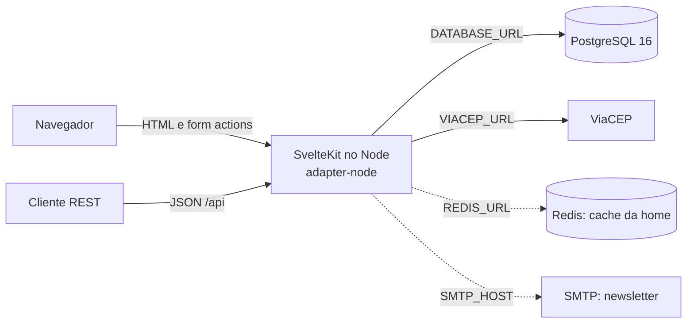
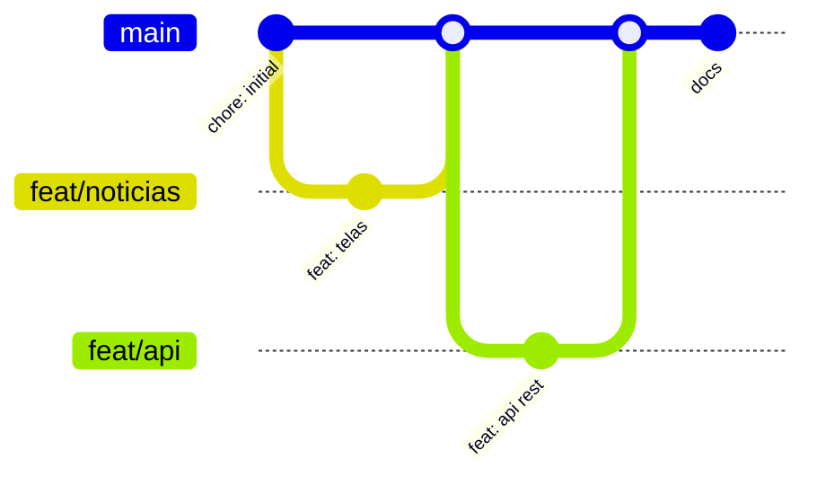

# Pauta e os quatro primeiros fatores do Twelve-Factor App

> **Summary.** Documento da 1ª etapa de Frameworks e APIs. Explica como o Pauta
> (SvelteKit) atende aos fatores I a IV: um repositório com GitHub Flow,
> dependências travadas pelo pnpm, configuração só por variáveis de ambiente e
> serviços de apoio trocáveis pela URL.

Faculdade Senac Cascavel, Padrões de Projetos, Frameworks e APIs.
Integrantes: Camilo Fernando Bomfim, Joaquim Augusto Nardino, Luana Mackieviez
e Lucas Pereira.

## Arquitetura

As linhas tracejadas são serviços planejados, ainda não implementados.

## I. Codebase

- **Repositório:** `pauta`, um só repositório git para o sistema todo. Vai
  para o GitHub da conta `kitsuneislife`.
- **Estratégia de branches:** GitHub Flow. A `main` está sempre pronta para
  rodar. Cada mudança nasce numa branch curta (`feat/...`, `fix/...`), vira
  pull request e volta para a `main`.
- **Por que GitHub Flow:** o projeto é pequeno, tem um ciclo de entrega só e
  não mantém versões antigas em paralelo. Git Flow, com `develop` e
  `release/*`, seria cerimônia sem retorno aqui.
- **Um código, vários ambientes:** o mesmo commit roda em desenvolvimento,
  homologação e produção. Só o `.env` muda.

## II. Dependencies

- **Ferramenta:** pnpm. **Arquivos:** `package.json` declara tudo, e o
  `pnpm-lock.yaml` trava a versão exata de cada pacote, inclusive das
  dependências indiretas.
- **Versões compatíveis:** o `package.json` fixa o gerenciador
  (`"packageManager": "pnpm@12.18.0"`) e o Node mínimo (`"engines"`). O
  `pnpm install` respeita o lockfile, então todo mundo instala a mesma árvore.
- **Nada implícito:** o banco também é declarado, no `compose.yaml`
  (`postgres:16-alpine`). Não depende de nada instalado à mão na máquina.
- **Do zero:** `pnpm install`, `pnpm db:start`, `pnpm db:migrate`,
  `pnpm db:seed` e `pnpm dev`.

## III. Config

Tudo o que muda entre ambientes vem do ambiente. O `.env.example` traz a lista
com valores fictícios. O `.env` real fica fora do git (`.gitignore`).

| Variável | Para quê | Lida por |
|---|---|---|
| `DATABASE_URL` | conexão com o PostgreSQL | `src/env.ts` (obrigatória) |
| `VIACEP_URL` | base da API de CEP | `src/env.ts` |
| `PUBLIC_APP_NAME` | nome no topo do site | `src/env.ts` (pública) |
| `PORT` | porta do servidor em produção | adapter-node |
| `ORIGIN` | URL pública, usada na proteção contra CSRF | adapter-node |
| `REDIS_URL` | cache da home (futuro) | ainda ninguém |
| `SMTP_HOST`, `SMTP_USER`, `SMTP_PASSWORD` | newsletter (futuro) | ainda ninguém |

O `src/env.ts` declara cada variável num lugar só. O código importa de
`$app/env/private` (só no servidor) ou de `$app/env/public` (pode ir ao
navegador). Se `DATABASE_URL` faltar, o app não sobe.

## IV. Backing services

Cada serviço é um recurso preso por uma URL. Trocar de serviço é trocar a
variável, sem mexer no código.

| Serviço | Estado | Variável | Como trocar |
|---|---|---|---|
| PostgreSQL | implementado | `DATABASE_URL` | Postgres local do Docker por um gerenciado (Neon, Supabase, RDS): basta a nova URL |
| ViaCEP | implementado | `VIACEP_URL` | outra instância ou um proxy com o mesmo formato de resposta |
| Redis | planejado | `REDIS_URL` | local ou Upstash |
| SMTP | planejado | `SMTP_HOST` e credenciais | servidor próprio ou Brevo |

O ViaCEP é chamado só no servidor, com tempo limite de 5 segundos. Se ele cair,
o cadastro de pessoa avisa o erro e não grava nada pela metade.

Trocar por um provedor com outro formato (por exemplo a BrasilAPI) exige
adaptar o `src/lib/server/viacep.ts`, que é o único arquivo que conhece a
resposta do serviço.

## Como o desenvolvimento funciona no SvelteKit

- Cada pasta em `src/routes` é uma rota. `+page.svelte` é a tela,
  `+page.server.ts` carrega dados (`load`) e trata formulários (`actions`), e
  `+server.ts` é um endpoint REST.
- Os formulários funcionam sem JavaScript no navegador: o servidor valida,
  responde com `fail()` em caso de erro ou redireciona em caso de sucesso.
- O Drizzle descreve as tabelas em TypeScript (`src/lib/server/schema.ts`) e o
  `drizzle-kit` gera as migrações em `drizzle/`.

## Vantagens e limitações

- **Vantagens:** pouco código para muita coisa (tela, validação e API no
  mesmo projeto), TypeScript do banco à tela, e formulários que funcionam
  mesmo sem JavaScript.
- **Limitações:** o ecossistema é menor que o do React e o do Spring. O
  SvelteKit 3 mudou APIs recentes (por exemplo o `$lib` e a declaração de
  variáveis de ambiente), então parte do material da internet está
  desatualizada.
